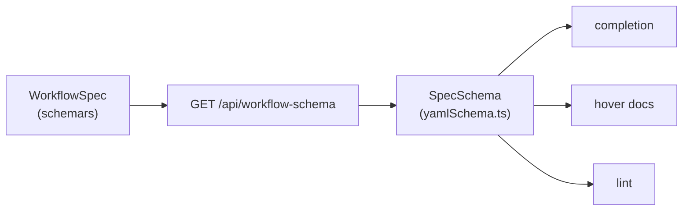

# Dashboard Frontend Design

The torc-dash UI is a Svelte 5 + TypeScript single-page app in `torc-dash/web/`. This page explains
how it is put together and the conventions to follow when changing it. The server it runs against is
described in [Web Dashboard Design](./dashboard.md).

## Build and delivery

- `npm run build` (Vite) writes the bundle to `torc-dash/static/app/`, which `torc-dash` embeds at
  compile time and serves at `/` (assets under `/static/app/`).
- **The built bundle is checked in**, so building torc never needs Node.js. Any UI change is
  committed together with its rebuilt `static/app/`. Asset names are content-hashed, so a rebuild
  replaces files rather than editing them.
- `npm run dev` serves the UI with hot reload and proxies `/api`, `/torc-service`, and
  `/static/images` to a running torc-dash (`TORC_DASH_URL`, default `http://127.0.0.1:8090`).
- Heavy libraries load on demand as separate chunks: Plotly (Resources), Cytoscape (Graph),
  marked/DOMPurify (chat Markdown), and the whole spec editor (CodeMirror, the YAML parser, the JSON
  Schema validator, templates). The main bundle stays near 275 KB.

## Structure

```
src/
  App.svelte            shell: sidebar, top bar, global shortcuts, auto-refresh, health check
  app.css               design tokens (light/dark), shared classes, read-only syntax colors (.hl)
  lib/
    state.svelte.ts     global app state (`app`) and tab list
    api/client.ts       typed torc-server client (openapi-fetch + generated schema.d.ts)
    api/dash.ts         torc-dash endpoints (/api/*): dashGet, dashPost, cli()
    highlight.ts        read-only YAML/JSON highlighting
    ui/                 DataTable, Modal, toasts, confirm(), LogSearch, Icon, ...
  features/<tab>/       one directory per tab or feature
tests/                  Node checks run by `npm test`
```

Feature directories own their components and state. A feature that other tabs open (job details,
file viewer, create-workflow modal) exposes a field on `app` (for example `app.jobDetailsId`) rather
than being imported by those tabs.

## State and data loading

- **Global state** lives in `app` (`lib/state.svelte.ts`) as Svelte 5 runes: the current tab
  (mirrored in the URL hash), the selected workflow, theme, refresh interval, and modal triggers.
- **Feature state that must outlive a tab switch** lives in module-level classes with rune fields:
  `execution` (run/watch output), `chat` and `specChat` (conversations), `draft` (the spec being
  edited), the event watcher.
- **Loading convention.** A feature reloads in an `$effect` that reads `app.refreshTick` (and
  `app.workflowId` if relevant). The tick increments on manual refresh and on the auto-refresh
  timer, which pauses while the window is hidden. Keep showing the previous data while a refresh is
  in flight; show a loading state only when there is nothing to show.
- **Persistence.** Preferences and conveniences use `localStorage` with `try`/`catch` around every
  access (it can be unavailable). Nothing that must not be lost lives only there. Saved items: the
  theme, selected workflow, refresh interval, editor draft, assistant panel state, and chat setup
  fields (never API keys).

## Talking to the backend

- **torc-server REST** goes through the proxy with the typed client:
  `unwrap(api.GET("/workflows/{id}", ...))`. Types come from `api/openapi.yaml` via
  `npm run gen:api`; `schema.d.ts` is generated and never edited. `listAll` pages through list
  endpoints.
- **torc-dash endpoints** use `dashGet` / `dashPost`, or `cli(endpoint, body)`, which throws with
  the command's stderr when it fails. Request and response types are declared next to the feature
  that uses them.
- **Streams.** Run/watch output uses `EventSource` on `/api/cli/run-stream`. Chat uses `fetch` on
  `POST /api/chat` and parses the SSE stream from the response body, since it needs a request body
  and cancellation through `AbortController`. Live workflow events come from torc-server's SSE
  stream through the proxy.
- **Errors** surface as toasts; error toasts persist until dismissed.

## Spec editor

The editor tab (`features/editor/`) is a CodeMirror 6 YAML editor driven by the workflow-spec JSON
Schema.



- `yamlSchema.ts` has no CodeMirror dependency, so it runs under Node in tests. Completion and hover
  compute the cursor's path (`jobs` → item → `resource_requirements`) from indentation rather than
  from a parse, so they work while the document is half typed. They follow `$ref`s and unwrap
  `Option` (`anyOf: [T, null]`). Block-style YAML only; flow collections get no completion.
- Lint parses with `yaml`, reports syntax errors, then validates with `@cfworker/json-schema`. The
  validator reports every level of nesting and both branches of each `anyOf`; lint keeps only the
  most specific error per location and rewrites it ("Unknown property", "Expected one of: ...").
- **Validate** runs the server-side dry run (`/api/cli/validate`), which catches what a schema
  cannot, such as references to undefined jobs or files.
- `cm.ts` wires the pieces into CodeMirror and themes it from the design tokens, so dark mode
  follows the app.
- **Templates** are a curated allowlist of `examples/yaml` files (`templates.ts`), bundled as lazy
  chunks; only listed files are included. **Snippets** (`snippets.ts`) append a block to the end of
  its top-level section, matching the section's indentation.
- **`draft`** holds the text and the file path on the torc-dash host. Every path that replaces the
  text goes through `draft.open()`, which asks before discarding unsaved edits.

## AI conversations

`ChatState` (`features/chat/chat.svelte.ts`) is one conversation: messages, streaming state, and the
SSE parsing. There are two instances:

- `chat` for the AI Chat tab, which sends the selected workflow ID as context.
- `specChat` for the editor's Assistant panel. Its `spec` binding (set in `draft.svelte.ts`)
  supplies the buffer with each message and applies `spec_edit` events. While the editor is open,
  edits go through `SpecEditor.applyEdit()`, which makes each one its own undo step and selects it;
  otherwise they apply to `draft.text` directly.

`ChatThread.svelte` renders either conversation. The provider is shared by both (it lives in
torc-dash), so a successful setup in either place marks both available. The editor is read-only
while `specChat.streaming`, which is what keeps the buffer consistent with torc-dash's copy (see
[AI chat](./dashboard.md#ai-chat)).

## Testing

- `npm run check`: svelte-check (types and Svelte diagnostics).
- `npm test`: Node checks with `--experimental-strip-types`, so tested modules must avoid
  TypeScript-only runtime syntax such as parameter properties. `highlight.check.ts` covers the
  read-only highlighters; `editor.check.ts` covers completion paths, hover, lint, snippet placement,
  and validates every `examples/yaml` spec against the schema from `torc workflows schema` (it runs
  `cargo`).
- UI behavior is verified by driving a running torc-dash in a browser; there is no browser test
  suite in the repository.

## Alternatives considered

- **Monaco** instead of CodeMirror: heavier, harder to theme from CSS variables, and its YAML
  support needs a language server.
- **`codemirror-json-schema`**: would pull in `shiki` (a large syntax-highlighting library) to
  render hover text, and validates with an older JSON Schema draft. The schema glue is about 250
  lines here.
- **Not checking in the bundle**: would make Node.js a build dependency of every torc build,
  including on HPC systems.
