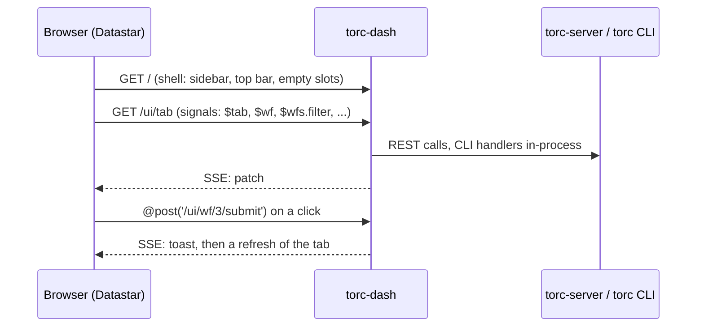

# Dashboard Frontend Design

The torc-dash UI is rendered on the server in Rust (maud templates) and made interactive in the
browser by [Datastar](https://data-star.dev), a small hypermedia library. This page explains how it
is put together and the conventions to follow when changing it. The server it runs in is described
in [Web Dashboard Design](./dashboard.md).

## Goals

- **Pure Rust, no build step.** There is no Node.js toolchain, bundle, or generated TypeScript
  client. The only JavaScript is Datastar itself (vendored, about 33 KB) and `shell.js`, a short
  hand-written file for preferences, the dashboard token, the action menu, and keyboard shortcuts.
- **Light.** Charts and the dependency graph are SVG drawn on the server, so the page loads no
  charting, graph, editor, or Markdown libraries and works without internet access.
- **One source of truth.** State that matters lives on the server; the browser holds only UI state
  (filters, the open tab, the selected workflow).

## Files

```
src/bin/torc-dash/ui/
  mod.rs          shell page, GET /ui/tab dispatch, tab list
  kit.rs          shared building blocks (below)
  workflows.rs    one module per tab or feature: routes() and, for tabs, view()
  details*.rs  dag.rs  events.rs  debugging.rs  resources.rs  editor.rs  create*.rs
  chat.rs  config.rs  wf_dialogs.rs  exec.rs
torc-dash/static/ui/
  datastar.js     vendored Datastar release (the version is in its first line)
  shell.js        the only hand-written script
  app.css         design tokens (light/dark, dark palettes) and shared component styles
  <feature>.css   one stylesheet per feature module
```

`torc-dash/static/` is embedded in the binary with `rust_embed`.

## How a request flows



- **The shell** (`GET /`) persists for the whole session. It holds the sidebar, the top bar, and
  slots that features fill: `#content` (the current tab), `#modals`, `#menu`, `#exec` (run/watch
  output), and `#toasts`.
- **Tabs are hash routes** (`#/details`). On a hash change the page sets `$tab` and calls
  `GET /ui/tab`, which runs the tab module's `view()` and patches the result into `#content`. The
  same call runs on Refresh, after actions (`Ui::refresh()`), and every `$refresh` seconds while the
  page is visible (`Ctx::auto` tells a view it is an automatic refresh).
- **Patches morph.** Datastar merges new HTML into elements with the same id, so re-rendering a
  whole tab keeps focus, typed text, scroll positions, and open `<details>`. Elements whose content
  the browser manages (log tails, the chat thread while streaming) are marked `data-ignore-morph`.
- **Signals** are Datastar's reactive state, sent with every request. Globals live on `<body>`:
  `$tab`, `$wf`, `$refresh`, `$allUsers`, `$archived`, `$group`, `$outputDir`, `$theme`, `$palette`.
  `shell.js` saves them to localStorage. Each tab owns one namespace object (`$wfs`, `$details`,
  `$dag`, ...) declared with `data-signals__ifmissing` so re-renders don't reset it. Signals whose
  names start with `_` stay in the browser.

## The kit

`ui/kit.rs` holds what every feature uses:

- **`Ui`**, the response type: a list of Datastar SSE events. `patch` (morph by id), `inner`,
  `append`, `remove`, `signals`, `script`, `toast`/`ok`/`err`, `modal`/`close_modal`, and `refresh`.
  `stream()` sends a series of `Ui`s over a long-lived response (run output, chat replies, live
  tails).
- **`Sig<T>`**, an extractor that deserializes the request's signals into `T`; `G` holds the global
  ones and `ns()` reads one tab's namespace.
- **torc-server access**: `get`, `api`, and `list_all` (pages through list endpoints) deserialize
  into `torc::models` types. The dashboard's basic-auth login is added as for the proxy.
- **`call`** invokes one of torc-dash's JSON handlers (`cli_*_handler`, chat, file and Slurm
  handlers) in-process and parses its reply, so the UI reuses the same code paths as the `/api/*`
  endpoints and the `torc` CLI. `op` runs a whitelisted CLI command through `build_op`.
- **Components**: `Table` (server-side sort, filter, paging, and row selection), `modal`,
  `seg_tabs`, `filter_box`, `badge`/`status_badge`, `icon`, `kv`, `stats`, and formatters.

## Conventions

- Put new routes under `/ui/`; the token guard covers them. A feature that other tabs open exposes a
  URL rather than a function: `GET /ui/job/{id}` (job details), `GET /ui/file?path=` (file viewer),
  `GET /ui/create/open`, `GET /ui/wf/{id}/<dialog>`, `POST /ui/exec/{id}/{mode}`.
- Simple confirmations use the browser's `confirm()`. Multi-step ones (initialize with missing
  files, delete selected) are dialogs the server returns.
- When a response removes the element that sent the request (closing a dialog), send signal patches
  before that element patch: Datastar stops reading a response whose initiating element is gone.
- Colors come from CSS variables, including in SVG, so everything follows the theme.
- Keep markup per row small: tables can show thousands of rows a page, and job lists can hold 100k.
- Verify UI changes in a browser, in light and dark themes, with no console errors.

## Notable features

- **Spec editor.** A `<textarea>` with a line-number gutter. As you type, the server parses the
  buffer with the real spec parser (`WorkflowSpec`) and reports errors with line numbers; clicking
  one selects the line. Templates come from `examples/yaml`, and snippets insert into the right
  section. The draft is kept in localStorage.
- **Dependency graph.** Laid out on the server with `rust-sugiyama`, one connected component at a
  time, then drawn as SVG with pan and zoom. Layouts are cached, so auto-refresh doesn't redo them.
- **Resource charts.** Plot data from `torc plot-resources` and live samples are drawn as SVG line
  and bar charts with `<title>` tooltips.
- **AI chat.** Conversations are kept on the server, keyed by an id the page generates, so a reply
  keeps streaming across tab switches. Markdown is rendered with `pulldown-cmark`, dropping raw
  HTML.
- **Run/watch output.** `POST /ui/exec/{id}/{mode}` opens the panel, which streams `torc run` or
  `torc watch` output. Closing the stream ends a watch; a run keeps going.

## Alternatives considered

- **The previous Svelte + TypeScript app.** Richer client-side widgets (CodeMirror completion,
  Plotly zoom), but it needed Node.js to change and a checked-in 6 MB bundle, duplicated validation
  that the Rust spec parser already does, and kept a second copy of state in the browser.
- **A native GPU UI (gpui).** Pure Rust, but it can't be served through an SSH tunnel to a browser
  or the Torc Desktop webview, which is how the dashboard reaches HPC login nodes.
