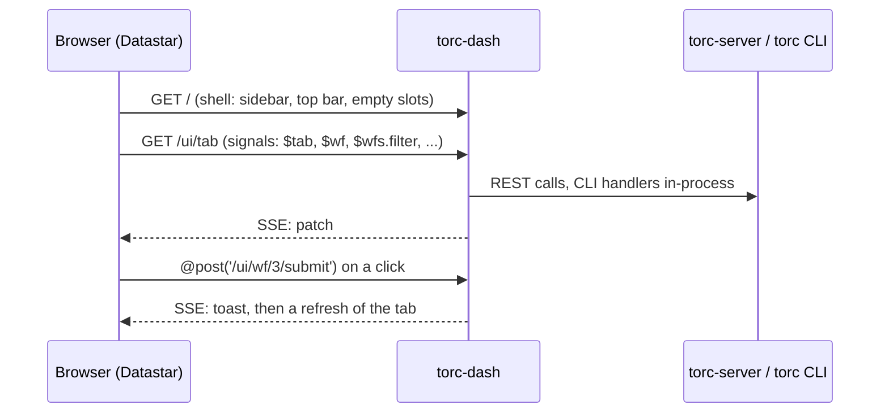

# Dashboard Frontend Design

The torc-dash UI is rendered on the server in Rust (maud templates) and made interactive in the
browser by [Datastar](https://data-star.dev), a small hypermedia library. This page explains how it
is put together and the conventions to follow when changing it. The server it runs in is described
in [Web Dashboard Design](./dashboard.md).

## Goals

- **Pure Rust, no build step.** There is no Node.js toolchain or generated TypeScript client. The
  JavaScript is two vendored libraries, Datastar (about 33 KB) and CodeMirror (for the spec editor
  only), plus two short hand-written files: `shell.js` (preferences, the dashboard token, the action
  menu, keyboard shortcuts) and `editor.js` (the spec editor).
- **Light.** Charts and the dependency graph are SVG drawn on the server, so the page loads no
  charting, graph, or Markdown libraries and works without internet access. CodeMirror (about 140 KB
  gzipped) loads only when the spec editor is opened.
- **One source of truth.** State that matters lives on the server; the browser holds only UI state
  (filters, the open tab, the selected workflow).

## Files

```
src/bin/torc-dash/ui/
  mod.rs          shell page, GET /ui/tab dispatch, tab list
  kit.rs          shared building blocks (below)
  workflows.rs    one module per tab or feature: routes() and, for tabs, view()
  details*.rs  dag.rs  events.rs  debugging.rs  resources.rs  editor.rs  create*.rs
  chat.rs  config.rs  wf_dialogs.rs  exec.rs
torc-dash/static/ui/
  datastar.js     vendored Datastar release (the version is in its first line)
  codemirror.js   vendored CodeMirror bundle (versions in its first line; see below)
  shell.js        hand-written: preferences, token, menus, shortcuts
  editor.js       hand-written: the spec editor, loaded on first use
  app.css         design tokens (light/dark, dark palettes) and shared component styles
  <feature>.css   one stylesheet per feature module
```

`torc-dash/static/` is embedded in the binary with `rust_embed`.

## How a request flows



- **The shell** (`GET /`) persists for the whole session. It holds the sidebar, the top bar, and
  slots that features fill: `#content` (the current tab), `#modals`, `#menu`, `#exec` (run/watch
  output), and `#toasts`.
- **Tabs are hash routes** (`#/details`). On a hash change the page sets `$tab` and calls
  `GET /ui/tab`, which runs the tab module's `view()` and patches the result into `#content`. The
  same call runs on Refresh, after actions (`Ui::refresh()`), and every `$refresh` seconds while the
  page is visible (`Ctx::auto` tells a view it is an automatic refresh).
- **Patches morph.** Datastar merges new HTML into elements with the same id, so re-rendering a
  whole tab keeps focus, typed text, scroll positions, and open `<details>`. Elements whose content
  the browser manages (log tails, the chat thread while streaming) are marked `data-ignore-morph`.
- **Signals** are Datastar's reactive state, sent with every request. Globals live on `<body>`:
  `$tab`, `$wf`, `$refresh`, `$allUsers`, `$archived`, `$group`, `$outputDir`, `$theme`, `$palette`.
  `shell.js` saves them to localStorage. Each tab owns one namespace object (`$wfs`, `$details`,
  `$dag`, ...) declared with `data-signals__ifmissing` so re-renders don't reset it. Signals whose
  names start with `_` stay in the browser.

## The kit

`ui/kit.rs` holds what every feature uses:

- **`Ui`**, the response type: a list of Datastar SSE events. `patch` (morph by id), `inner`,
  `append`, `remove`, `signals`, `script`, `toast`/`ok`/`err`, `modal`/`close_modal`, and `refresh`.
  `stream()` sends a series of `Ui`s over a long-lived response (run output, chat replies, live
  tails).
- **`Sig<T>`**, an extractor that deserializes the request's signals into `T`; `G` holds the global
  ones and `ns()` reads one tab's namespace.
- **torc-server access**: `get`, `api`, and `list_all` (pages through list endpoints) deserialize
  into `torc::models` types. torc-dash adds its torc-server login (basic auth) to these requests.
- **`call`** invokes one of torc-dash's JSON handlers (`cli_*_handler`, chat, file and Slurm
  handlers) in-process and parses its reply, so the UI reuses the same code paths as the `/api/*`
  endpoints and the `torc` CLI. `op` runs a whitelisted CLI command through `build_op`.
- **Components**: `Table` (server-side sort, filter, paging, and row selection), `modal`,
  `seg_tabs`, `filter_box`, `badge`/`status_badge`, `icon`, `kv`, `stats`, and formatters.

## Conventions

- Put new routes under `/ui/`; the token guard covers them. A feature that other tabs open exposes a
  URL rather than a function: `GET /ui/job/{id}` (job details), `GET /ui/file?path=` (file viewer),
  `GET /ui/create/open`, `GET /ui/wf/{id}/<dialog>`, `POST /ui/exec/{id}/{mode}`.
- Simple confirmations use the browser's `confirm()`. Multi-step ones (initialize with missing
  files, delete selected) are dialogs the server returns.
- When a response removes the element that sent the request (closing a dialog), send signal patches
  before that element patch: Datastar stops reading a response whose initiating element is gone.
- Colors come from CSS variables, including in SVG, so everything follows the theme.
- Keep markup per row small: tables can show thousands of rows a page, and job lists can hold 100k.
- Verify UI changes in a browser, in light and dark themes, with no console errors.

## Notable features

- **Spec editor.** CodeMirror, with syntax highlighting, folding, search, and lint marks. The text
  stays in `$editor.text`: a hidden text area bound to the signal carries edits both ways, so
  templates, opened files, and the assistant's edits replace the editor's text like any other signal
  patch. The editing intelligence is on the server: `/ui/editor/lint` runs the real spec parser and
  dry-run validation plus schema checks (unknown keys, values outside an enum), which also fill the
  problem list below the editor; `/ui/editor/complete` and `/ui/editor/hover` (YAML) read the
  `schemars` schema of `WorkflowSpec` in `ui/spec_schema.rs`, finding the cursor's place from
  indentation so they work on half-typed text. Templates come from `examples/yaml`, and snippets
  insert into the right section. The draft is kept in localStorage.
- **Dependency graph.** Laid out on the server with `rust-sugiyama`, one connected component at a
  time, then drawn as SVG with pan and zoom. Layouts are cached, so auto-refresh doesn't redo them.
- **Resource charts.** Plot data from `torc plot-resources` and live samples are drawn as SVG line
  and bar charts with `<title>` tooltips.
- **AI chat.** Conversations are kept on the server, keyed by an id the page generates, so a reply
  keeps streaming across tab switches. Markdown is rendered with `pulldown-cmark`, dropping raw
  HTML.
- **Run/watch output.** `POST /ui/exec/{id}/{mode}` opens the panel, which streams `torc run` or
  `torc watch` output. Closing the stream ends a watch; a run keeps going.

## Updating vendored libraries

`datastar.js` is the release file from the Datastar repository. `codemirror.js` is a bundle of the
CodeMirror packages `editor.js` imports, made once with Node.js outside the repository:

```bash
npm i esbuild codemirror @codemirror/{view,state,lang-yaml,lang-json,autocomplete,lint,language,commands} @lezer/highlight
cat > entry.js <<'EOF'
export { basicSetup } from "codemirror";
export { EditorView, keymap, hoverTooltip } from "@codemirror/view";
export { EditorState, Compartment } from "@codemirror/state";
export { yaml } from "@codemirror/lang-yaml";
export { json } from "@codemirror/lang-json";
export { autocompletion, insertCompletionText, pickedCompletion } from "@codemirror/autocomplete";
export { linter, lintGutter, forceLinting } from "@codemirror/lint";
export { HighlightStyle, syntaxHighlighting, indentUnit } from "@codemirror/language";
export { indentWithTab } from "@codemirror/commands";
export { tags } from "@lezer/highlight";
EOF
npx esbuild entry.js --bundle --format=esm --minify --legal-comments=none \
  --banner:js="// CodeMirror 6 (<package versions>), MIT. Rebuild: see docs/src/specialized/design/dashboard-frontend.md." \
  --outfile=torc-dash/static/ui/codemirror.js
```

## Alternatives considered

- **The previous Svelte + TypeScript app.** Richer client-side widgets (Plotly zoom, draggable graph
  nodes), but it needed Node.js to change and a checked-in 6 MB bundle, duplicated validation that
  the Rust spec parser already does, and kept a second copy of state in the browser.
- **A plain `<textarea>` for the spec editor.** No library, but no highlighting, completion, or
  inline errors, which made the editor clearly worse than the Svelte app's.
- **A native GPU UI (gpui).** Pure Rust, but it can't be served through an SSH tunnel to a browser
  or the Torc Desktop webview, which is how the dashboard reaches HPC login nodes.
