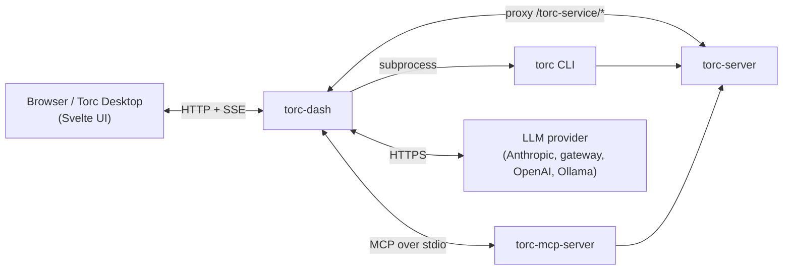
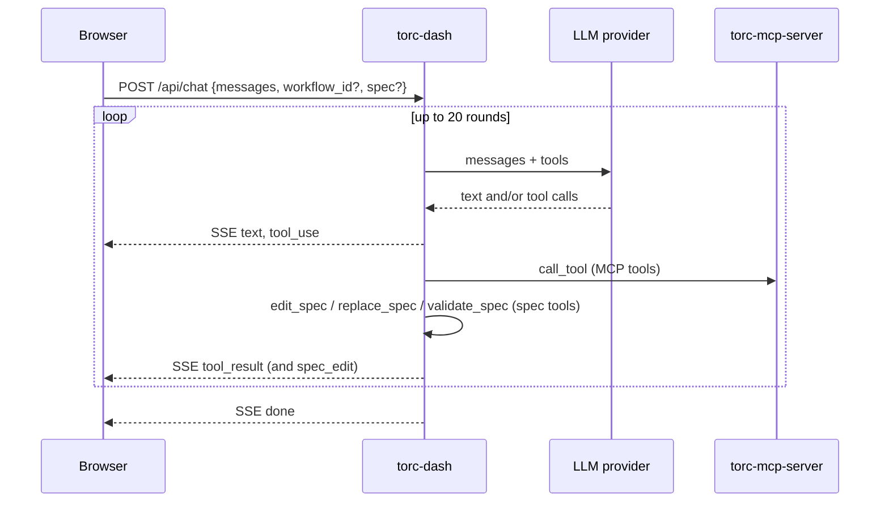

# Web Dashboard Design (torc-dash)

`torc-dash` serves the browser UI for Torc and acts as the gateway between that UI and everything
else: torc-server, the `torc` CLI, the Torc MCP server, and an optional LLM provider for the AI
features. This page covers the server (`src/bin/torc-dash.rs`). The browser UI is described in
[Dashboard Frontend Design](./dashboard-frontend.md), and the desktop app that hosts it in
[Torc Desktop Design](./desktop.md).

## Problem and goals

Users need a visual way to create, run, monitor, and debug workflows, often on HPC login nodes they
reach only over SSH. The design goals:

- **One binary, no runtime dependencies.** The UI is embedded; Node.js is needed only to change it.
- **Same behavior as the CLI.** Operations that the CLI already implements (create, run, submit,
  recover, ...) must not be reimplemented with subtly different semantics.
- **Safe on shared machines.** A login node has many users; the dashboard must be reachable only by
  its owner.
- **Works against any torc-server**: a shared, authenticated one or a private one it starts itself.

## Architecture

torc-dash has five jobs:

1. **Serve the UI**: the built Svelte app, embedded with `rust_embed` from `torc-dash/static/`.
2. **Proxy the REST API**: `/torc-service/*` is forwarded to torc-server unchanged, so the UI uses
   the OpenAPI-typed client directly.
3. **Run CLI commands**: `/api/cli/*` endpoints run `torc` as a subprocess for anything that
   involves files, multi-step logic, or long-running execution.
4. **Manage a private torc-server** in standalone mode.
5. **Host the AI chat**: an LLM tool loop over the MCP server's tools, plus spec-editing tools.

## Startup and configuration

Settings merge from, highest priority first: command-line flags, environment variables, and the
`[dash]` section of the torc config file (see
[Configuration](../../core/reference/configuration.md)).

- **Listener.** `--port` (TCP, default host `127.0.0.1`) or `--socket <path>` (UNIX domain socket,
  created with mode `0600` after removing a stale file). A socket restricts access to the owning
  user at the OS level, which is why it is the recommended mode on login nodes and the one Torc
  Desktop uses. With `--socket`, a managed server is forced onto `127.0.0.1`.
- **Standalone mode** (`--standalone`) spawns `torc-server` (on `--server-port`, or port 0 for a
  free one) and reads the `TORC_SERVER_PORT=<port>` line it prints to learn the actual port. The API
  URL then points at that server. Stopping torc-dash stops it. The managed server binds `0.0.0.0` by
  default so compute nodes can reach it; with `--socket` (or `--server-host 127.0.0.1`, as Torc
  Desktop passes) it stays on loopback.
- **Ready signal.** torc-dash logs `Dashboard available at http://host:port` (or `unix:<path>`).
  Torc Desktop parses this line to learn the port in local mode.

## HTTP surface

Routes are grouped by what backs them. The full list is the `Router::new()` block in `main`.

| Group      | Routes                                                     | Backed by                   |
| ---------- | ---------------------------------------------------------- | --------------------------- |
| UI         | `/`, `/static/*`                                           | embedded assets             |
| REST proxy | `/torc-service/*` (all methods)                            | torc-server                 |
| Lifecycle  | `/api/cli/*`: create, validate, run, submit, cancel, ...   | `torc` subprocess           |
| Streaming  | `GET /api/cli/run-stream`                                  | `torc run` / `watch` as SSE |
| Files      | `/api/cli/*`: read-file, write-file, export, import, plots | filesystem, `torc`          |
| Slurm      | `/api/cli/*`: slurm-parse-logs, slurm-sacct, hpc-profiles  | `torc`                      |
| Spec       | `GET /api/workflow-schema`                                 | JSON Schema from Rust types |
| Server     | `/api/server/{start,stop,status}`                          | managed torc-server         |
| AI chat    | `/api/chat`, `/api/chat/status`, `/api/chat/configure`     | LLM provider + MCP          |
| Info       | `/api/version`, `/api/user`                                | torc-dash itself            |

### REST proxy and authentication

The proxy forwards method, headers (except `Host`), and body to `<api_url>/<path>`. If torc-server
requires a login, torc-dash reads `TORC_PASSWORD` (and `TORC_USERNAME`, defaulting to `USER`) at
startup, exactly as the CLI does, and adds HTTP basic auth to proxied requests that don't already
carry an `Authorization` header. The credentials are added only on requests to torc-server, never to
other hosts that share the same HTTP client (such as the LLM provider). CLI subprocesses inherit the
same environment variables, so they authenticate the same way.

### CLI delegation

`run_torc_command` runs `torc` with `TORC_API_URL` set to the dashboard's server and returns
`{success, stdout, stderr, exit_code}`. Endpoints pass `-f json` where they parse the output. Inline
specs (create, validate) are written to a temp file with the right extension first; `dry_run_spec`
does this for `torc create --dry-run` and is shared by `/api/cli/validate` and the chat's
`validate_spec` tool.

Delegating keeps one implementation of each operation, gives the dashboard local file access with
the user's permissions, and guarantees CLI and dashboard behave the same. The cost is a process per
request and parsing CLI output, which is acceptable at dashboard request rates.

### Streaming execution

`/api/cli/run-stream` runs `torc run <id>` (mode `run`) or `torc watch <id> --show-job-counts`
(modes `watch`, `watch-recover` with `--recover`) and streams Server-Sent Events:

| Event                | Data                                                        |
| -------------------- | ----------------------------------------------------------- |
| `start`              | what is running                                             |
| `stdout` / `stderr`  | one line of CLI output                                      |
| `status`             | job counts by status, polled from the API every few seconds |
| `end`                | `success` or the failure reason                             |
| `exit_code`, `error` | process exit code; errors starting or reading the process   |

Watch modes are spawned with `kill_on_drop`, so closing the stream (the UI's Stop) ends the watcher.
A `run` is deliberately not killed when the stream closes: stopping the output must not abort jobs.
The UI says so and offers **Cancel workflow** instead.

### Spec schema

`GET /api/workflow-schema` returns `workflow_spec_schema()`: a JSON Schema (draft 2020-12) generated
with `schemars` from `WorkflowSpec` and the types it contains, with doc comments as descriptions.
`torc workflows schema` prints the same document. Serving it from torc-dash keeps the editor's
completion and lint in step with the torc version actually installed. See
[Adding workflow spec fields](../../contributing.md#adding-workflow-spec-fields).

## AI chat

- **Providers.** One provider is active per torc-dash process, held in `AppState` (`llm_*` fields)
  and shared by every conversation. It is set at startup from flags/environment or at runtime with
  `/api/chat/configure` (memory only). Anthropic-format providers (direct API, Azure AI Foundry, and
  gateways such as LiteLLM) use `<base>/v1/messages`; OpenAI, Ollama, and GitHub Models use
  `/chat/completions`. `ANTHROPIC_BASE_URL` and `ANTHROPIC_AUTH_TOKEN` have Claude Code's meaning (a
  gateway root, and a bearer token), so a Claude Code gateway setup works unchanged.
- **Tools.** torc-dash starts `torc-mcp-server` lazily as a child process speaking MCP over stdio,
  and offers its tools to the model. The model's tool calls run in torc-dash, not in the browser, so
  API keys and torc credentials never reach the page.
- **Workflow context.** The AI Chat tab sends the selected workflow ID, which goes into the system
  prompt as the default for tool calls.
- **Spec editing.** When the request comes from the spec editor it includes `spec`, the editor's
  buffer. torc-dash then puts the buffer in the system prompt, withholds the MCP `create_workflow`
  tool, and adds three local tools that act on this request's copy of the buffer:
  `edit_spec(old_str, new_str)` (the snippet must occur exactly once), `replace_spec(content)`, and
  `validate_spec()`. Each successful edit is streamed to the browser as a `spec_edit` event, which
  the editor applies. The editor is read-only while the response streams, so the browser's buffer
  and torc-dash's copy cannot diverge; the next message carries the buffer as it then is.
- **History.** The browser sends the conversation as plain text turns. Tool calls are not replayed
  in later requests; the model re-queries tools (or reads the current spec) as needed.

## Security model

- **Who can connect.** Over a socket, only the owning user (mode `0600`). Over TCP, anyone who can
  reach the port, so the default bind is `127.0.0.1`; on shared hosts use `--socket`. Remote access
  goes through an SSH tunnel, never an exposed port.
- **What a connection can do.** Everything the owning user can: run `torc`, read and write files
  (`read-file`, `write-file`, export/import), and use their torc-server credentials. torc-dash adds
  no authentication of its own, so the transport is the boundary.
- **Cross-site requests.** The JSON endpoints require `Content-Type: application/json`, which makes
  cross-origin pages send a CORS preflight that torc-dash never approves, so a hostile page in the
  same browser cannot call them. The chat endpoints also compare the `Origin` header with `Host`.
- **Known gaps.** `GET /api/cli/run-stream?mode=run` starts a run and, being a plain GET, can be
  triggered by another page without a preflight (it cannot read the result, and needs a valid
  workflow ID). torc-dash does not validate the `Host` header, so a DNS-rebinding page could appear
  same-origin. Both are mitigated by binding to loopback or a socket and are tracked for hardening.

## Alternatives considered

- **Browser talks to torc-server directly.** Would need CORS on torc-server, expose its credentials
  to the page, and still need a local process for file access and CLI operations.
- **Reimplement operations in the dashboard.** Faster per request, but two implementations of
  workflow creation, recovery, and submission would drift.
- **Run the LLM tool loop in the browser.** Would put API keys and torc credentials in the page and
  need a browser MCP client; the server-side loop keeps both on the machine running torc-dash.
- **Merge AI edits with concurrent user typing.** Would need operational transforms or round trips
  from browser to server mid-response; turn-taking (read-only during a response) is simpler and
  matches how users work with the assistant.
