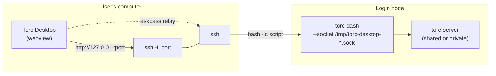

# Torc Desktop Design

Torc Desktop (`torc-desktop/`) is a native app that runs the torc-dash UI in its own window, with
torc-dash running either on the user's computer or on an HPC login node over SSH. It is a standalone
Tauri 2 crate, not part of the main workspace. Usage is in
[Desktop App](../../core/monitoring/desktop.md); this page explains how it works and why.

## Problem and goals

Using torc-dash on a login node by hand means starting it, picking a free port or socket, opening an
SSH tunnel, and remembering to stop everything afterwards. The goals:

- **One click to a dashboard** on a remote login node, including password and MFA prompts.
- **No exposed ports** on the shared login node, and nothing left running after disconnecting.
- **Use the user's existing SSH setup** (`~/.ssh/config`, `ProxyJump`, keys, Kerberos).
- **Same UI** as the browser version; the app adds no UI of its own beyond the connect page.

## Architecture

The connect page (`ui/index.html`, a static form with a short script that uses Tauri's global API)
collects the target and calls the `connect` command in `src-tauri/src/main.rs`, which starts the
session, waits for the dashboard, and navigates the window to it. From then on the window shows
torc-dash's own UI.

## Remote mode

`ssh_command` runs the system `ssh` with:

- `-L 127.0.0.1:<port>:/tmp/torc-desktop-<random>.sock`: forwards a local loopback port to a UNIX
  socket on the login node. torc-dash creates the socket with mode `0600`, so only the user can
  connect on the login node, and only local processes can reach the forwarded port. No TCP port is
  opened on the shared host.
- `ExitOnForwardFailure=yes` (fail rather than run without the tunnel), `ServerAliveInterval=30`
  (notice a dead link within about 90 seconds), `LogLevel=ERROR` (keep login banners out of error
  messages), and `-T` (no terminal).

The remote command (`remote_command`) is one line, free of newlines and `!`, so it survives csh and
tcsh login shells. It runs under `bash -lc` so `module` and the login `PATH` work, and sources the
user's `~/.bash_profile`, which is where `TORC_PASSWORD`, `TORC_API_URL`, and the `ANTHROPIC_*`
variables are expected. The script:

1. `cd`s to the optional working directory (left unquoted so `~` and `$VARS` expand),
2. runs the optional environment setup (for example `module load torc`),
3. starts `torc-dash --socket <path>` in the background,
4. keeps the ssh session's stdin open on a spare descriptor and runs a watcher that kills torc-dash
   when that stdin closes,
5. removes the socket on exit.

The watcher is how the remote side cleans up: when the app quits, disconnects, or the connection
drops, ssh's stdin closes on the login node, and torc-dash (with any private torc-server it started)
stops. Without it, a dropped connection would leave torc-dash running.

**Readiness.** The forward accepts TCP connections before the remote socket exists, so
`dashboard_ready` sends a real `GET /` through the tunnel and waits for `HTTP/1.1 200`.

## Local mode

`local_command` runs `torc-dash --host 127.0.0.1 --port <port>` through the user's login shell
(`$SHELL -lc`, then `/bin/sh` for the actual command, because the login shell may be csh or fish),
so profile settings such as `TORC_PASSWORD` apply. torc-dash logs the port it bound, which the app
reads from its output.

Release bundles ship `torc-dash`, `torc`, `torc-server`, and `torc-mcp-server` next to the app's
executable (Tauri `externalBin`, configured in `src-tauri/tauri.bundle.conf.json`). The app runs
that `torc-dash` by absolute path and points it at the other three with `TORC_BIN`,
`TORC_SERVER_BIN`, and `TORC_MCP_SERVER_BIN`, so local mode needs nothing on `PATH` and always
matches the app's version. Apps started from Finder get a minimal `PATH`, and a non-interactive zsh
login shell skips `~/.zshrc`, so relying on `PATH` failed for many users. Dev builds without the
bundled binaries fall back to `torc-dash` from `PATH` (with `~/.cargo/bin` and Homebrew appended).
The externalBin list is kept out of `tauri.conf.json` because tauri-build fails when the files are
missing, which would break `cargo clippy` and `cargo test` for the crate.

## Passwords and MFA (askpass relay)

ssh asks for passwords through `SSH_ASKPASS` when it has no terminal. The app sets `SSH_ASKPASS` to
its own executable and `SSH_ASKPASS_REQUIRE=force`. When started with `TORC_DESKTOP_ASKPASS_ADDR`
set, the executable acts as the helper: it sends the prompt to the running app over a loopback TCP
connection, along with a random per-launch token (`TORC_DESKTOP_ASKPASS_TOKEN`), waits for the
answer, and prints it for ssh. The app ignores connections without the token, shows the prompt in
the window (masked unless it is a yes/no host-key question), and relays the answer. Cancelling, or
disconnecting while a prompt is open, makes the helper exit non-zero, which ssh treats as cancel.

This keeps every SSH authentication method working, including keyboard-interactive MFA, without the
app handling keys or implementing SSH itself.

## Session lifecycle

- **Process group.** ssh (or local torc-dash) starts in its own process group. `kill_ssh` signals
  the whole group, so local helpers and anything torc-dash started locally stop too. It also drops
  pending askpass prompts.
- **Monitoring.** `watch_connection` checks every two seconds whether ssh has exited. If it has, the
  window returns to the connect page with `#lost`, which shows a one-click **Reconnect**.
- **Quit.** `RunEvent::Exit` runs `kill_ssh`; the remote watcher then stops torc-dash.
- **Timeout.** Connecting fails after 180 seconds, generous enough for typing a password and an MFA
  code. The last few KB of ssh and torc-dash output are kept and shown on failure.

## Stable local port

The dashboard keeps preferences, the spec editor draft, and chat setup in `localStorage`, which the
webview stores per origin (`http://127.0.0.1:<port>`). A random port per connection would give each
session a new, empty origin. `local_port` derives the port from the connection target (the SSH host,
or `local`) with FNV-1a, in the range 20000–29999 (outside the OS ephemeral ranges), and falls back
to a free port if it is taken. Each target keeps its own saved settings across reconnects and app
restarts.

## Torc server choice

The connect page passes one of three choices to torc-dash (`server_flags`):

- **Shared server URL**: `--api-url <url>` (must be `http(s)://`; anything else is rejected rather
  than passed to a shell).
- **Blank**: no flag, so torc-dash uses `TORC_API_URL` or `[dash] api_url` from the torc config
  where it runs.
- **Private server**: `--standalone --server-host 127.0.0.1 --database <path>`, with the database in
  `~/torc-desktop.db` on the login node or the app's data folder locally. Loopback-only, because a
  private server on a shared node must not be reachable by other users.

## Downloads, file pickers, and notifications

The window is created in `setup` (`"create": false` in `tauri.conf.json`) so it can have an
`on_download` handler; without one, the webviews drop downloads. A download needs a destination
before it starts, and a save dialog cannot answer synchronously from the webview's callback, so the
file goes to a fresh temporary directory first. When it finishes, a native save dialog
(tauri-plugin-dialog) asks where to keep it, and the file is moved there. The dashboard should start
downloads from `<a download>` links: WebKit downloads a plain navigation only when it cannot display
the response type, so a JSON attachment would replace the page.

`<input type="file">` needs nothing: wry implements WebKit's open panel on macOS, and WebView2 and
WebKitGTK show their own pickers.

The dashboard notifies with the Web Notification API. tauri-plugin-notification injects a
`window.Notification` polyfill into every page that sends it to the OS. The `dashboard` capability
lets the remote origin `http://127.0.0.1:*` call only the plugin's permission and notify commands;
it gets no other IPC. `app.withGlobalTauri` (which the connect page needs, having no bundler) also
defines `window.__TAURI__` in the dashboard, but capabilities, not that object, decide what a page
may call, so this grants nothing more.

## Build and distribution

- CI (`.github/workflows/dashboard.yml`) runs `cargo fmt`, clippy, and the unit tests on macOS for
  every pull request.
- Tagged releases (`.github/workflows/release.yml`) build installers on each OS: a `.dmg` for macOS
  on Apple Silicon, an `.AppImage` and a `.deb` for Linux x86_64 (built on Ubuntu 22.04 for older
  glibc), and `.msi` and NSIS `.exe` installers for Windows x64, using the Tauri CLI installed with
  `cargo install`. They are attached to the GitHub release. No Node.js is involved.
- The macOS app is ad-hoc signed (`signingIdentity: "-"`), not signed with a Developer ID or
  notarized, so users clear the quarantine flag once after downloading (see the README).
- The app's version follows torc's. `tauri.conf.json` has no version, so Tauri uses
  `src-tauri/Cargo.toml`, which `cargo release` updates along with its lock file (`release.toml`).

## Alternatives considered

- **Built-in SSH library** (for example `russh`): would need its own config parsing, `ProxyJump`,
  agent, Kerberos, and MFA support. The system `ssh` already does all of that the way users have
  configured it.
- **TCP port on the login node**: any user on the node could connect to it, and torc-dash has no
  authentication of its own. A `0600` UNIX socket limits access at the OS level.
- **Leaving torc-dash running between sessions** (reconnect to an existing one): faster reconnects,
  but long-lived processes on login nodes are discouraged and would outlive the user's intent.
- **Electron**: larger bundles and a bundled Chromium; Tauri uses the OS webview.
