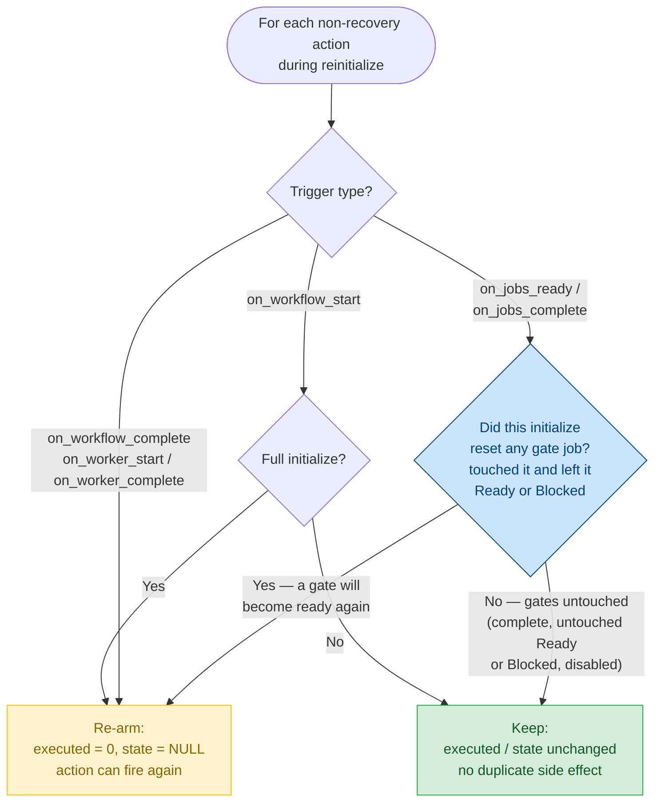

# Workflow Actions

Workflow actions enable automatic execution of commands and resource allocation in response to
workflow lifecycle events. Actions provide hooks for setup, teardown, monitoring, and dynamic
resource management throughout workflow execution.

## Overview

Actions consist of three components:

1. **Trigger** - The condition that activates the action
2. **Action Type** - The operation to perform
3. **Configuration** - Parameters specific to the action

```yaml
actions:
  - trigger_type: "on_workflow_start"
    action_type: "run_commands"
    commands:
      - "mkdir -p output logs"
      - "echo 'Workflow started' > logs/status.txt"
```

## Trigger Types

### Workflow Lifecycle Triggers

#### `on_workflow_start`

Executes when the workflow is initialized from the top.

**When it fires**: During a full `initialize_jobs` (the first initialize, or `torc workflows init`,
which resets every job), after jobs are transitioned from uninitialized to ready/blocked states. It
does **not** fire again on a _partial_ reinitialize (`torc workflows reinit`,
`torc jobs reset-status --reinit`, `recover`) — a partial reinit is not a new start (see
[Workflow Reinitialization](#workflow-reinitialization)).

**Typical use cases**:

- Scheduling Slurm allocations
- Creating directory structures
- Copying initial data

```yaml
- trigger_type: "on_workflow_start"
  action_type: "run_commands"
  commands:
    - "mkdir -p output checkpoints temp"
    - "echo 'Workflow started at $(date)' > workflow.log"
```

#### `on_workflow_complete`

Executes once when all jobs reach terminal states (completed, failed, or canceled).

**When it fires**: After the last job completes, as detected by the job runner.

**Typical use cases**:

- Archiving final results
- Uploading to remote storage
- Cleanup of temporary files
- Generating summary reports

```yaml
- trigger_type: "on_workflow_complete"
  action_type: "run_commands"
  commands:
    - "tar -czf results.tar.gz output/"
    - "aws s3 cp results.tar.gz s3://bucket/results/"
    - "rm -rf temp/"
```

### Job-Based Triggers

#### `on_jobs_ready`

Executes when **all** specified jobs have reached the "ready" state in the current run.

**When it fires**: When no specified job is still `uninitialized` or `blocked`. A job that has moved
past ready (pending, running, `pending_failed`, finished) still counts, so an action created mid-run
fires for jobs that are already running.

**Typical use cases**:

- Scheduling Slurm allocations
- Starting phase-specific monitoring
- Pre-computation setup
- Notifications before expensive operations

```yaml
- trigger_type: "on_jobs_ready"
  action_type: "schedule_nodes"
  jobs: ["train_model_001", "train_model_002", "train_model_003"]
  scheduler: "gpu_cluster"
  scheduler_type: "slurm"
  num_allocations: 2
```

**Important**: The action triggers only when **all** matching jobs are ready, not individually as
each job becomes ready.

#### `on_jobs_complete`

Executes when **all** specified jobs reach terminal states (completed, failed, canceled, or
terminated).

**When it fires**: When the last specified job finishes execution. A job awaiting AI classification
(`pending_failed`) is not finished yet, and a failed job that is retried goes back to ready, so the
action waits for the retry.

**Typical use cases**:

- Scheduling Slurm allocations
- Cleaning up intermediate files
- Archiving phase results
- Freeing storage space
- Phase-specific reporting

```yaml
- trigger_type: "on_jobs_complete"
  action_type: "run_commands"
  jobs: ["preprocess_1", "preprocess_2", "preprocess_3"]
  commands:
    - "echo 'Preprocessing phase complete' >> workflow.log"
    - "rm -rf raw_data/"
```

### Worker Lifecycle Triggers

Worker lifecycle triggers are **persistent by default**, meaning they execute once per worker (job
runner), not once per workflow.

#### `on_worker_start`

Executes when each worker (job runner) starts.

**When it fires**: After a job runner starts and checks for workflow actions, before claiming any
jobs.

**Typical use cases**:

- Worker-specific initialization
- Setting up worker-local logging
- Copying data to compute node local storage
- Initializing worker-specific resources
- Recording worker startup metrics

```yaml
- trigger_type: "on_worker_start"
  action_type: "run_commands"
  persistent: true  # Each worker executes this
  commands:
    - "echo 'Worker started on $(hostname) at $(date)' >> worker.log"
    - "mkdir -p worker_temp"
```

#### `on_worker_complete`

Executes when each worker completes (exits the main loop).

**When it fires**: After a worker finishes processing jobs and before it shuts down.

**Typical use cases**:

- Worker-specific cleanup
- Uploading worker-specific logs
- Recording worker completion metrics
- Cleaning up worker-local resources

```yaml
- trigger_type: "on_worker_complete"
  action_type: "run_commands"
  persistent: true  # Each worker executes this
  commands:
    - "echo 'Worker completed on $(hostname) at $(date)' >> worker.log"
    - "rm -rf worker_temp"
```

## Job Selection

For `on_jobs_ready` and `on_jobs_complete` triggers, specify which jobs to monitor.

### Exact Job Names

```yaml
- trigger_type: "on_jobs_complete"
  action_type: "run_commands"
  jobs: ["job1", "job2", "job3"]
  commands:
    - "echo 'Specific jobs complete'"
```

### Regular Expressions

```yaml
- trigger_type: "on_jobs_ready"
  action_type: "schedule_nodes"
  job_name_regexes: ["train_model_[0-9]+", "eval_.*"]
  scheduler: "gpu_cluster"
  scheduler_type: "slurm"
  num_allocations: 2
```

**Common regex patterns**:

- `"train_.*"` - All jobs starting with "train_"
- `"model_[0-9]+"` - Jobs like "model_1", "model_2"
- `".*_stage1"` - All jobs ending with "_stage1"
- `"job_(a|b|c)"` - Jobs "job_a", "job_b", or "job_c"

### Combining Selection Methods

You can use both together - the action triggers when **all** matching jobs meet the condition:

```yaml
jobs: ["critical_job"]
job_name_regexes: ["batch_.*"]
# Triggers when "critical_job" AND all "batch_*" jobs are ready/complete
```

## Action Types

### `run_commands`

Execute shell commands sequentially on a compute node.

**Configuration**:

```yaml
- trigger_type: "on_workflow_complete"
  action_type: "run_commands"
  commands:
    - "tar -czf results.tar.gz output/"
    - "aws s3 cp results.tar.gz s3://bucket/"
```

**Execution details**:

- Commands run in the workflow's output directory
- Commands execute sequentially (one after another)
- If a command fails, the action fails (but workflow continues)
- Commands run on compute nodes, not the submission node
- Uses the shell environment of the job runner process

### `schedule_nodes`

Dynamically allocate compute resources from a Slurm scheduler.

**Configuration**:

```yaml
- trigger_type: "on_jobs_ready"
  action_type: "schedule_nodes"
  jobs: ["train_model_1", "train_model_2"]
  scheduler: "gpu_cluster"
  scheduler_type: "slurm"
  num_allocations: 2
```

**Parameters**:

- `scheduler` (required) - Name of Slurm scheduler configuration (must exist in `slurm_schedulers`)
- `scheduler_type` (required) - Must be "slurm"
- `num_allocations` (required) - Number of Slurm allocation requests to submit
- `start_one_worker_per_node` (optional, default: false) - Launch one worker per allocated node via
  `srun --ntasks-per-node=1`. Use this for direct-mode workflows with single-node jobs sharing a
  multi-node allocation. Not compatible with `execution_config.mode: slurm`.

**Use cases**:

- Just-in-time resource allocation
- Cost optimization (allocate only when needed)
- Separating workflow phases with different resource requirements

**Recommended: tie `schedule_nodes` to jobs with `on_jobs_ready`.** Prefer `on_jobs_ready` (gated on
the jobs the allocation will run) over `on_workflow_start` for scheduling — even for root jobs,
which are `Ready` at init so the action fires at the same moment. The reason is re-run safety: when
you reset a subset of jobs and reinitialize, a job-gated action whose jobs were reset is re-armed,
so the next `torc submit` re-schedules exactly those jobs (see
[Re-running on Slurm](#re-running-a-slurm-workflow)). An `on_workflow_start` action is kept
(suppressed) on reinitialize and cannot be re-fired by `submit`, so the reset job would have no
allocation. `torc slurm generate` now emits `on_jobs_ready[root_jobs]` for no-dependency jobs for
this reason.

`on_workflow_start` `schedule_nodes` is still valid when a single allocation serves the whole
workflow (it can't be gated on jobs that aren't all ready at once), but that allocation is not
selectively re-run-safe — re-run it with `torc recover` or a manual `torc slurm schedule-nodes`.

## Complete Examples

Refer to this
[example](https://github.com/NatLabRockies/torc/blob/main/examples/yaml/workflow_actions_simple_slurm.yaml)

## Execution Model

### Action Claiming and Execution

1. **Atomic Claiming**: Actions are claimed atomically by workers to prevent duplicate execution
2. **Non-Persistent Actions**: Execute once per workflow (first worker to claim executes)
3. **Persistent Actions**: Can be claimed and executed by multiple workers
4. **Trigger Evaluation**: Job-based triggers are evaluated from the gate jobs' current statuses
   when actions are listed or claimed, so retries, resets, and late-created actions need no
   bookkeeping. A claim re-checks the condition in the same statement, so a client holding an
   out-of-date pending list cannot claim an action that is no longer triggered (409,
   `state: not_triggered`). `trigger_count` in the API is the number of gate jobs satisfying the
   trigger now. Event triggers (`on_workflow_start`, `on_workflow_complete`, `on_worker_*`) are
   armed once when the event happens.
5. **Immediate Availability**: Worker lifecycle actions are immediately available after workflow
   initialization

### Action Outcomes

The server records what happened to each action in its `state` and `error` fields (API 1.1.0):

| `state`      | Meaning                                                                   |
| ------------ | ------------------------------------------------------------------------- |
| (null)       | Never claimed, or claimed through an older server or client               |
| `claimed`    | A worker or `torc submit` claimed it and has not reported an outcome yet  |
| `succeeded`  | The claimer executed it successfully                                      |
| `failed`     | Execution failed; `error` holds the claimer's message (e.g. sbatch error) |
| `suppressed` | Disabled without executing (see below)                                    |

`executed` is still the "not available to claim" flag, so `get_pending_actions` and older clients
work unchanged. The endpoints that move an action between states are:

- `POST /workflows/{id}/actions/{action_id}/claim` sets `claimed`. A non-persistent action is also
  marked `executed`; a persistent one stays claimable. A 409 body includes the action's `state`, so
  a caller can tell "another process is running it" from "it was suppressed".
- `POST /workflows/{id}/actions/{action_id}/result` with `{"success": bool, "error": "..."}` records
  `succeeded` or `failed`. The claimer calls it after executing the action. For a persistent action
  it records the latest outcome. It returns 409 if the action has no claim (or was suppressed) and
  422 if `error` is set with `success: true`.
- `POST /workflows/{id}/actions/{action_id}/suppress` sets `executed` and `suppressed` without
  running the action. It is idempotent. A persistent action can be suppressed in any state, since a
  claim never consumes it; a non-persistent action only while unclaimed (409 otherwise).
- `POST /workflows/{id}/actions/{action_id}/reset` re-arms a `failed`, `suppressed`, or stuck
  `claimed` action: it clears `executed`, `executed_at`, `executed_by`, `state`, and `error`. It
  returns 409 for a `succeeded` action.

Torc does **not** retry a failed action. A `schedule_nodes` action with `num_allocations > 1` can
partly succeed, so a retry could submit duplicate allocations. Instead, `torc status` lists failed
actions, and actions claimed more than 30 minutes ago with no outcome, with their errors;
`torc workflows list-actions` shows `state` and `error`; and `torc recover` lists failed
`schedule_nodes` actions and, in the interactive wizard on a running workflow, offers to reset them
and submit their allocations. To retry by hand, fix the cause and run
`torc workflows reset-action <workflow_id> <action_id>`; the action fires the next time a worker or
`torc submit` looks for pending actions.

Three places suppress actions instead of running them: disabling an action in the `torc submit`
re-submission review, `suppress_satisfied_schedule_actions` (used by `torc recover` and
`torc slurm schedule-nodes --suppress-actions`), and the `apply_scheduler_plan` transaction behind
`torc slurm regenerate`. All three suppress persistent `schedule_nodes` actions too. Against a
server older than API 1.1.0 the client falls back to claiming, which cannot stop a persistent
action, and skips outcome reporting.

A client older than API 1.1.0 claims actions but never reports a result, so its claims stay
`claimed`, and `torc status` reports them as stuck after 30 minutes.

### Action Lifecycle

```
[Workflow Created]
    ↓
[initialize_jobs called]
    ↓
├─→ on_workflow_start actions become pending
├─→ on_worker_start actions become pending (persistent)
├─→ on_worker_complete actions become pending (persistent)
└─→ on_jobs_ready actions become pending once all their jobs have reached ready
    ↓
[Worker Claims and Executes Actions]
    ↓
[Jobs Execute]
    ↓
[Jobs Complete]
    ↓
├─→ on_jobs_complete actions become pending when all specified jobs complete
└─→ on_workflow_complete actions become pending when all jobs complete
    ↓
[Workers Exit]
    ↓
[on_worker_complete actions execute per worker]
```

### Important Characteristics

1. **No Rollback**: Failed actions don't affect workflow execution; they are recorded as `failed`
2. **Compute Node Execution**: Actions run on compute nodes via job runners
3. **One-Time Triggers**: Non-persistent actions trigger once when conditions are first met
4. **No Inter-Action Dependencies**: Actions don't depend on other actions
5. **Concurrent Workers**: Multiple workers can execute different actions simultaneously

### Workflow Reinitialization

Every reinitialize entry point — `torc workflows reinit`, `torc jobs reset-status --reinit`,
`torc recover`, and the Slurm `regenerate`/`watch` paths — funnels through the single server routine
`reset_actions_for_reinitialize`, which runs inside the `initialize_jobs` transaction. For each
action it decides whether to **re-arm** the action (clear `executed`/`executed_by`/`state` so it can
fire again on the new run) or **keep** its executed state (including `suppressed`).

The decision follows one rule, independent of `action_type`:

> Re-arm an action **iff its triggering condition will genuinely re-occur in the new run.**

A user who reinitializes after resetting a _subset_ of jobs expects only those jobs to re-run.
Actions tied to events that are not happening again must not re-fire — a re-fired action re-submits
its Slurm allocation (`schedule_nodes`) or re-runs its commands (`run_commands`), and that duplicate
side effect is the bug. This is why the decision is **not** specific to `schedule_nodes`: the hazard
is "duplicate side effect," not "duplicate allocation."

#### Re-arm decision



Per trigger:

- **`on_jobs_ready` / `on_jobs_complete` → re-arm iff this initialize reset at least one gate job.**
  A gate counts as reset when it ends `Ready` or `Blocked` and the initialize touched it: either it
  was `Uninitialized` after the uninitialize step (reset directly, or a transitive descendant of a
  reset job) or its status changed (for example a `Ready` gate pushed back to `Blocked` because its
  upstream job was reset). Such a gate will become ready again in the new run. Gates the initialize
  did not touch keep the action as it is: a gate that is still complete, an untouched `Ready` gate
  (its allocation may still be queued), an untouched `Blocked` gate, or a disabled gate. A
  suppressed action is re-armed only when its own gates are reset. A full `torc workflows init`
  resets every job first, so every gate counts as reset there.
- **`on_workflow_start` → keep on a partial reinitialize** (`reinit`, `reset-status --reinit`,
  `recover`, `regenerate`, `watch`). A partial reinit is not a new start, so this stops it from
  re-running start-time setup or re-submitting the original node count. A full `torc workflows init`
  re-arms it. (A never-fired action keeps `executed = 0` and still fires.) The server distinguishes
  the two by `only_uninitialized`: `false` = full, `true` = partial.
- **`on_workflow_complete`, `on_worker_start`, `on_worker_complete` → re-arm.** These recur every
  run (the workflow will complete again; new workers start), so they should fire again.

**Why not look at current job states alone.** After the initialize, a reset gate and a gate that was
already `Ready` look the same, and so do an untouched `Blocked` gate and one that was just reset.
Only the before/after comparison tells them apart. If an action was claimed for a gate that is still
`Ready` and its allocation was later cancelled, re-arm it with
`POST /workflows/{id}/actions/{action_id}/reset`.

**Example — subset re-run vs. full re-run**:

- `gate_job` runs first; an `on_jobs_complete` action (a `schedule_nodes` allocation or a
  `run_commands` archive step) fires when it completes. A later `work_job` depends on `gate_job`.

_Subset re-run_ (the common reschedule-the-failure case):

1. `gate_job` completes (action fires); `work_job` later fails.
2. User resets only the failed job and reinitializes. `gate_job` stays `Completed` (terminal).
3. The action is **kept executed** — it is not re-armed, so no duplicate allocation/command runs
   when a worker starts.

_Full re-run_ (the gate itself is re-run):

1. Same first run as above.
2. User resets `gate_job` itself and reinitializes. `gate_job` returns to a non-terminal state.
3. The action is **re-armed**, so when `gate_job` completes again in the new run it fires again.

With multiple gating jobs, the action is only kept when the initialize reset **none** of them;
resetting any one of them re-arms it.

The `recover` path keeps its own `suppress_satisfied_schedule_actions` guard (the `regenerate` path
suppresses the same actions inside the `apply_scheduler_plan` transaction), and it is
**load-bearing, not just redundant**: those paths take over allocation themselves (they submit the
user's chosen count, or regenerate recovery actions and submit). After they reset the failed jobs
and reinitialize, the server _correctly_ re-arms those jobs' `on_jobs_ready` actions (right for
plain `reinit`, where they should fire), but the reset gate is now `Ready`, so the action is
satisfied and would fire on the first worker and submit a second allocation. The guard suppresses
those satisfied actions so recover's own submission is not duplicated. The server cannot do this —
it can't tell "recover is about to allocate these jobs itself" from "plain reinit, the action should
fire." For the `on_workflow_start` and already-terminal-gated cases the guard is now a no-op (the
server already keeps those executed, and the guard skips already-executed actions); the
reset-`on_jobs_ready` case is the one it still handles.

### Re-running a Slurm workflow

`torc submit` fires **every pending Slurm `schedule_nodes` action**, regardless of trigger type
(`on_workflow_start` to bootstrap, plus `on_jobs_ready`/`on_jobs_complete` whose gating jobs are
ready). Combined with the re-arm logic above, this gives a clean selective re-run:

```bash
torc jobs reset-status <id1> <id2> ... --reinit   # reset the jobs to re-run + reinitialize
torc submit <workflow_id>                          # re-schedule exactly those jobs
```

Because reinitialize re-arms only the job-gated actions whose jobs were reset (untouched stages stay
suppressed), the re-armed actions for the reset jobs become pending and `submit` schedules just
their allocations — nothing for the stages that did not change. Worked example: a workflow with
separate `on_jobs_ready` `schedule_nodes` actions for regular, big-memory, and GPU job classes;
reset only the GPU and big-memory jobs and reinitialize, and `submit` re-schedules only the GPU and
big-memory allocations. Downstream actions (e.g. a postprocess gated on all classes) are not yet
pending — they fire later, from a running worker, once their jobs become ready
(`job_runner::check_and_execute_actions`).

This is why job-gated scheduling is recommended over `on_workflow_start` (which `submit` cannot
re-fire once kept). `submit` itself is one-shot: it submits the currently-pending allocations and
returns. For an unattended multi-stage re-run, follow it with `torc watch` so that if every worker
exits (e.g. Slurm walltime) before a later stage's action fires, the stranded action is picked up
(`torc watch --auto-schedule`).

`submit` re-fires each action's `num_allocations` **verbatim** — it does not right-size the re-run.
So the re-run granularity is the action granularity: per-stage/per-class actions reschedule only the
affected subset, but a single large fan-in action (e.g. one `on_jobs_ready` gating 100k jobs with
`num_allocations: 500`) re-arms as a whole when any subset is reset, and `submit` re-submits its
full count even if only a handful of jobs need to re-run. For a right-sized partial re-run of such a
stage, use `torc recover`, which regenerates `schedule_nodes` actions sized to the actually-pending
jobs (and suppresses the spec's full-size action via `suppress_satisfied_schedule_actions`).

## Limitations

1. **No Action Dependencies**: Actions cannot depend on other actions completing
2. **No Conditional Execution**: Actions cannot have conditional logic (use multiple actions with
   different job selections instead)
3. **No Action Retries**: Failed actions are not automatically retried; reset them with
   `torc workflows reset-action` after fixing the cause
4. **Single Action Type**: Each action has one action_type (cannot combine run_commands and
   schedule_nodes)
5. **Job Selectors Are Spec-Time Only**: An action's job names/patterns are fixed when the workflow
   is created and don't update if new jobs are added later (e.g. by
   [`spawn_jobs`](../../core/tutorials/dynamic-jobs.md))

For complex workflows requiring these features, consider:

- Using job dependencies to order operations
- Creating separate jobs for conditional logic
- Implementing retry logic within command scripts
- Creating multiple actions for different scenarios
